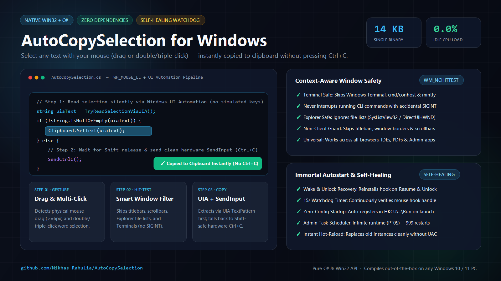

# ⚡ AutoCopySelection for Windows

<p align="center">
  
</p>

<p align="center">
  
  
  
  
</p>

**AutoCopySelection** is an ultra-lightweight (**14 KB**), zero-dependency native Windows daemon written in C# & Win32 API that brings Linux/X11-style **auto-copy on text selection** to Windows — without breaking terminals, file selection in Explorer, or window dragging.

Select any text with your mouse (**drag selection** or **double/triple-click**) in any browser, IDE, PDF reader, or desktop app, and it is **instantly copied to your clipboard** without pressing `Ctrl+C`.

---

## ✨ Why AutoCopySelection?

Most auto-copy scripts (AutoHotkey snippets, browser extensions, or simple mouse hooks) fail in daily use because they blindly spam `Ctrl+C` on every mouse release — killing running CLI commands in Windows Terminal (`SIGINT`), copying files when dragging a selection box on the Desktop/Explorer, or dying silently after Windows wakes from sleep.

**AutoCopySelection solves all of this:**

1. **Silent UI Automation First (`TextPattern.GetSelection`):**
   - Queries the focused element via Windows UI Automation (`AutomationElement.FocusedElement`) and extracts selected text directly into the clipboard (`Clipboard.SetText`) **without simulating any keystrokes**.
   - If the target application doesn't expose UIA `TextPattern`, it waits for `Shift` release (preventing accidental `Ctrl+Shift+C` DevTools triggers) and sends a clean hardware `SendInput` (`Ctrl+C`).
2. **Context-Aware Window & Hit-Test Filtering (`WM_NCHITTEST`):**
   - **Terminal Safe:** Automatically skips `Windows Terminal` (`CASCADIA_HOSTING_WINDOW_CLASS`), `cmd.exe` / `PowerShell` (`ConsoleWindowClass`), and `mintty` (Git Bash) so it **never** interrupts running terminal processes.
   - **Explorer & Desktop Safe:** Skips `SysListView32`, `DirectUIHWND`, `SysTreeView32`, `Progman`, `WorkerW`, and `Shell_TrayWnd` so marquee-selecting files or icons never overwrites your clipboard.
   - **Non-Client Area Guard:** Uses `SendMessageTimeout(..., WM_NCHITTEST, ...)` to ignore window titlebar dragging, border resizing, and scrollbar dragging (`!= HTCLIENT`).
   - **Physical Input Only:** Ignores synthetic/injected mouse events (`LLMHF_INJECTED`).
3. **Immortal Self-Healing Architecture:**
   - **Sleep & Lock Recovery:** Subscribes to `SystemEvents.PowerModeChanged` (`Resume`) and `SystemEvents.SessionSwitch` (`SessionUnlock`, `ConsoleConnect`) to automatically reinstall the low-level mouse hook whenever Windows wakes up or unlocks.
   - **15-Second Watchdog:** Continuously verifies the `WH_MOUSE_LL` hook handle.
   - **Dual Autostart (Zero Config):**
     - Simply running `AutoCopySelection.exe` automatically registers it in `HKCU\Software\Microsoft\Windows\CurrentVersion\Run`.
     - Running `install.bat` (as Admin) compiles from source using the built-in Windows .NET compiler (`csc.exe`) and registers `AutoCopySelectionTask` in **Windows Task Scheduler** (`RunLevel=Highest`, `ExecutionTimeLimit=PT0S` infinite runtime, `RestartCount=999`, `AllowStartIfOnBatteries`).

---

## 🚀 Quick Start (Installation)

### Option 1: One-Click Run (No Admin Required)
Download **[`AutoCopySelection.exe`](../../releases/latest)** (or from this repo) and double-click it.
- It immediately starts in the background (0% CPU, ~8 MB RAM).
- It automatically adds itself to your Windows startup (`HKCU\...\Run`).

### Option 2: Compile from Source + Immortal Admin Task (`install.bat`)
Every Windows 10 and Windows 11 installation includes the native C# compiler (`C:\Windows\Microsoft.NET\Framework64\v4.0.30319\csc.exe`). No Visual Studio or SDK installation is needed!

1. Clone or download this repository:
   ```cmd
   git clone https://github.com/Mikhas-Rahulia/AutoCopySelection.git
   cd AutoCopySelection
   ```
2. Right-click **`install.bat`** → **Run as administrator** (or run normally).
   - Compiles `AutoCopySelection.cs` → `AutoCopySelection.exe`.
   - Registers `AutoCopySelectionTask` in Task Scheduler with `Highest` privileges (so auto-copy works even inside elevated Admin windows) and infinite execution time (`PT0S`).

### Uninstall / Stop
- Run **`uninstall.bat`** or execute:
  ```cmd
  AutoCopySelection.exe --uninstall
  ```
- To stop the running background instance without uninstalling:
  ```cmd
  AutoCopySelection.exe --stop
  ```

---

## 🇷🇺 Описание на русском

**AutoCopySelection** — сверхлёгкая (**14 КБ**) системная утилита для Windows 10/11 на чистом C# и Win32 API, которая автоматически копирует любой выделенный мышью текст в буфер обмена **без нажатия `Ctrl+C`**.

### Как это работает:
- **Жесты выделения:** Реагирует только на физическое выделение текста мышью — протяжку с зажатой ЛКМ (`>= 6px`) или двойной/тройной клик по слову/абзацу.
- **Двухэтапное копирование:** Сначала пытается бесшумно прочитать выделенный текст напрямую через **Windows UI Automation (`TextPattern`)**, вообще не нажимая клавиш. Если программа не поддерживает UIA, ждёт отпускания клавиши `Shift` и отправляет быстрый аппаратный `SendInput (Ctrl+C)`.
- **Умные исключения (`ShouldSkipWindow`):**
  - Не срабатывает при перетаскивании окон за заголовок, рамок изменения размера и полос прокрутки (`WM_NCHITTEST != HTCLIENT`).
  - Не копирует файлы при выделении рамкой на Рабочем столе и в Проводнике (`SysListView32`, `DirectUIHWND`).
  - Игнорирует терминалы (`Windows Terminal`, `cmd`, `PowerShell`, `Git Bash / mintty`), чтобы никогда не прервать запущенную команду сигналом `Ctrl+C`.
- **Неубиваемый автозапуск:**
  - При обычном запуске `AutoCopySelection.exe` сам прописывает себя в автозагрузку реестра (`HKCU\Software\Microsoft\Windows\CurrentVersion\Run`).
  - При установке через `install.bat` от имени администратора создаёт задачу `AutoCopySelectionTask` в Планировщике заданий Windows с бесконечным временем работы (`ExecutionTimeLimit = PT0S`), работой от батареи и автоперезапуском при сбоях (`RestartCount = 999`).
  - Автоматически переустанавливает хук мыши после выхода из спящего режима (`PowerModes.Resume`) и разблокировки экрана (`Win+L`).

---

## 📄 License

Released under the [MIT License](LICENSE).
