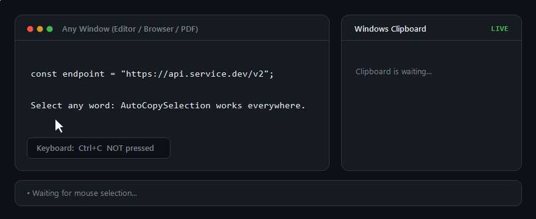

# AutoCopySelection for Windows

<p align="center">
  
</p>

<p align="center">
  <a href="assets/demo.webm">Watch / Download Schematic WebM (assets/demo.webm)</a>
</p>

<p align="center">
  
  
  
  
</p>

**AutoCopySelection** is an ultra-lightweight (**14 KB**), zero-dependency native Windows daemon written in C# and Win32 API that brings **auto-copy on text selection** to Windows — without breaking terminals, file selection in Explorer, or window dragging.

Select any text with your mouse (**drag selection** or **double/triple-click**) in any browser, IDE, PDF reader, or desktop app, and it is **instantly copied to your clipboard** without pressing `Ctrl+C`.

---

## Why AutoCopySelection?

Most auto-copy scripts (AutoHotkey snippets, browser extensions, or simple mouse hooks) fail in daily use because they blindly spam `Ctrl+C` on every mouse release — killing running CLI commands in Windows Terminal (`SIGINT`), copying files when dragging a selection box on the Desktop/Explorer, or dying silently after Windows wakes from sleep.

**AutoCopySelection solves all of this:**

1. **Silent UI Automation First (`TextPattern.GetSelection`):**
   - Queries the focused element via Windows UI Automation (`AutomationElement.FocusedElement`) and extracts selected text directly into the clipboard (`Clipboard.SetText`) **without simulating any keystrokes**.
   - If the target application doesn't expose UIA `TextPattern`, it waits for `Shift` release (preventing accidental `Ctrl+Shift+C` DevTools triggers) and sends a clean hardware `SendInput` (`Ctrl+C`).
2. **Context-Aware Window & Hit-Test Filtering (`WM_NCHITTEST`):**
   - **Terminal Safe:** Automatically skips `Windows Terminal` (`CASCADIA_HOSTING_WINDOW_CLASS`), `cmd.exe` / `PowerShell` (`ConsoleWindowClass`), and `mintty` (Git Bash) so it **never** interrupts running terminal processes.
   - **Explorer & Desktop Safe:** Skips `SysListView32`, `DirectUIHWND`, `SysTreeView32`, `Progman`, `WorkerW`, and `Shell_TrayWnd` so marquee-selecting files or icons never overwrites your clipboard.
   - **Non-Client Area Guard:** Uses `SendMessageTimeout(..., WM_NCHITTEST, ...)` to ignore window titlebar dragging, border resizing, and scrollbar dragging (`!= HTCLIENT`).
   - **Physical Input Only:** Ignores synthetic/injected mouse events (`LLMHF_INJECTED`).
3. **Self-Healing Architecture:**
   - **Sleep & Lock Recovery:** Subscribes to `SystemEvents.PowerModeChanged` (`Resume`) and `SystemEvents.SessionSwitch` (`SessionUnlock`, `ConsoleConnect`) to automatically reinstall the low-level mouse hook whenever Windows wakes up or unlocks.
   - **15-Second Watchdog:** Continuously verifies the `WH_MOUSE_LL` hook handle.
   - **Dual Autostart (Zero Config):**
     - Simply running `AutoCopySelection.exe` automatically registers it in `HKCU\Software\Microsoft\Windows\CurrentVersion\Run`.
     - Running `install.bat` (as Admin) compiles from source using the built-in Windows .NET compiler (`csc.exe`) and registers `AutoCopySelectionTask` in **Windows Task Scheduler** (`RunLevel=Highest`, `ExecutionTimeLimit=PT0S` infinite runtime, `RestartCount=999`, `AllowStartIfOnBatteries`).

---

## Engineering Approach & Facts

Instead of shipping a heavy wrapper, a background runtime, or a naive script that blindly sends `Ctrl+C`, **AutoCopySelection** was built as a low-level Windows systems utility:

| Metric / Aspect | Implementation |
| :--- | :--- |
| **Compiled Binary Size** | **13.8 KB** (`13,824 bytes`) single standalone `.exe` |
| **Source Code Footprint** | **~460 lines** of pure C# with direct Win32 P/Invoke (`user32.dll`, `kernel32.dll`) |
| **External Dependencies** | **0** — compiles out-of-the-box on any Windows 10/11 PC via built-in `csc.exe` |
| **Hook Latency (`WH_MOUSE_LL`)** | **< 0.05 ms** non-blocking callback (integer math + bounded `BlockingCollection(4)`) |
| **Idle CPU Usage** | **0.0%** (event-driven hook + blocked consumer queue) |
| **Hung Window Protection** | `SendMessageTimeout` with `SMTO_ABORTIFHUNG` capped at **40 ms** |

### Key Architectural Decisions:
1. **Non-Blocking Mouse Hook + Background Queue:**
   Windows lags the cursor or silently drops low-level mouse hooks (`LowLevelHooksTimeout`) if the `WH_MOUSE_LL` callback blocks. In [AutoCopySelection.cs](AutoCopySelection.cs), `HookCallback` performs only fast O(1) coordinate math (`dx² + dy² >= 36` for a `6px` drag threshold; `GetDoubleClickTime() + 60ms` within an `8px` radius for multi-click) and enqueues a struct into a bounded `BlockingCollection<CopyRequest>(4)`. All hit-testing, UIA COM calls, and clipboard operations run asynchronously on a dedicated background `STA` thread.
2. **Hung-Window Protection (`SMTO_ABORTIFHUNG`):**
   Querying window hit-tests (`WM_NCHITTEST`) on an unresponsive application can freeze a naive utility. By using `SendMessageTimeout` with `SMTO_ABORTIFHUNG` and a strict `40 ms` timeout, a frozen third-party window can never stall the daemon.
3. **Modifier-Safe Fallback (`Shift` Release Polling):**
   When a user selects text using `Shift + Click`, firing `Ctrl+C` while `Shift` is still physically held down results in `Ctrl+Shift+C` (which opens browser DevTools instead of copying). When UIA `TextPattern` isn't supported by an older window, the worker polls `GetAsyncKeyState(VK_SHIFT)` for up to `450 ms` until `Shift` is released before dispatching hardware `SendInput`.
4. **Zero-UAC Hot Reloading:**
   Uses a global singleton `Mutex` paired with a named `EventWaitHandle` (`Global\AutoCopySelection_ExitEvent`) so new builds or `--stop` / `--uninstall` commands can cleanly signal an elevated instance to unhook and exit without triggering UAC prompts.

---

## Quick Start (Installation)

### Option 1: One-Click Run (No Admin Required)
Download **[`AutoCopySelection.exe`](../../releases/latest)** (or from this repo) and double-click it.
- Starts immediately in the background (0% CPU, ~8 MB RAM).
- Automatically adds itself to your Windows startup (`HKCU\...\Run`).

### Option 2: Compile from Source + Admin Task (`install.bat`)
Every Windows 10 and Windows 11 installation includes the native C# compiler (`C:\Windows\Microsoft.NET\Framework64\v4.0.30319\csc.exe`). No Visual Studio or SDK installation is needed.

1. Clone or download this repository:
   ```cmd
   git clone https://github.com/Mikhas-Rahulia/AutoCopySelection.git
   cd AutoCopySelection
   ```
2. Right-click **`install.bat`** -> **Run as administrator** (or run normally).
   - Compiles `AutoCopySelection.cs` -> `AutoCopySelection.exe`.
   - Registers `AutoCopySelectionTask` in Task Scheduler with `Highest` privileges (so auto-copy works even inside elevated Admin windows) and infinite execution time (`PT0S`).

### Uninstall / Stop
- Run **`uninstall.bat`** or execute:
  ```cmd
  AutoCopySelection.exe --uninstall
  ```
- To stop the running background instance without uninstalling:
  ```cmd
  AutoCopySelection.exe --stop
  ```

---

## License

Released under the [MIT License](LICENSE).
